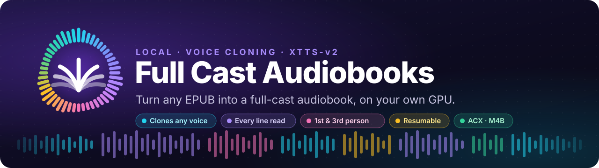
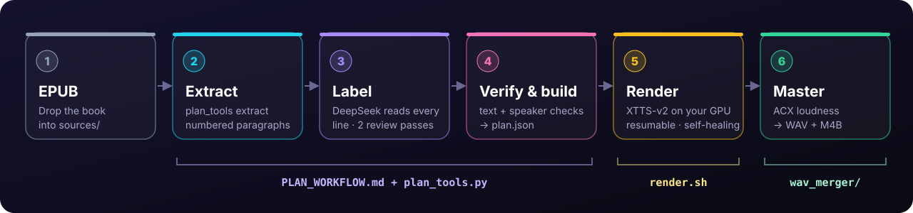
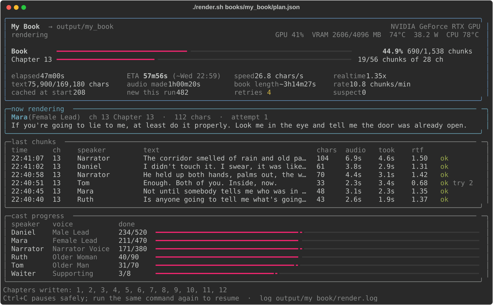

<div align="center">



<br>


**[Features](#-features) · [How it works](#-how-it-works) · [Quick start](#-quick-start) · [Rendering](#-rendering) · [Planning](#-planning-a-book) · [Voices](#-voices) · [FAQ](#-faq--troubleshooting)**

</div>

<br>

Full Cast Audiobooks turns an EPUB into a **multi-voice audiobook** on your own
machine. It extracts the text, gives every line to the right speaker, **clones a
voice for each character** from a short clip with Coqui XTTS-v2, and masters the
chapters into an ACX-ready M4B.

There's no cloud TTS, no API keys and no per-word cost.

<br>

## ✨ Features

<table>
<tr>
<td width="50%" valign="top">

### 🎭 The right voice on every line
An LLM reads **the whole book**, labels chapters in parallel, then checks the
result with a second, independent review. If it's still unsure who said a
main-character line, it asks you, with context.

</td>
<td width="50%" valign="top">

### 📖 Any point of view
Supports first person, third person and **deep third-person limited**. Inner
thoughts go to the character who thinks them, and POV headers go to the right
voice.

</td>
</tr>
<tr>
<td valign="top">

### 📊 A live dashboard
Shows book and chapter progress, ETA, chars/s, realtime factor, the line being
rendered now, recent chunks, cast progress, and GPU and CPU heat.

</td>
<td valign="top">

### 🛟 Crash-proof and resumable
You can press Ctrl+C at any time. A crash restarts on its own (up to 5 times),
and files damaged by a power cut are detected and redone.

</td>
</tr>
<tr>
<td valign="top">

### 🧬 Clone any voice
Give a character 30–60 s of clean speech and XTTS-v2 clones it. Chunks are
cached by content, so swapping a voice re-renders **only that speaker's lines**.

</td>
<td valign="top">

### 🎯 Built-in quality check
A take that's too short or too long for its text is re-rolled. Anything still
suspicious goes in a report with the chapter and timestamp.

</td>
</tr>
<tr>
<td valign="top">

### 🖱️ Drag and drop
Drop a `plan.json` on the launcher, or on a desktop icon. Run an
**audition** to hear the whole cast before you commit to a full render.

</td>
<td valign="top">

### 🎚️ Mastered output
The bundled merger joins the chapters, applies ACX loudness and peak limits,
and exports an **M4B with chapter markers**.

</td>
</tr>
</table>

<br>

## 🧭 How it works

<p align="center">
  
</p>

| Stage | Tool | What it does |
| --- | --- | --- |
| **Plan** | [`PLAN_WORKFLOW.md`](PLAN_WORKFLOW.md) + `plan_tools.py` | An LLM reads the book and labels every paragraph. The tools prove no text was dropped or changed, flag suspicious labels, and build `plan.json`. |
| **Render** | `render.sh` | Clones each speaker's voice with XTTS-v2, voices every line and writes one lossless WAV per chapter. |
| **Master** | `wav_merger/` | Joins the chapters, applies ACX mastering and exports WAV + M4B. |

<br>

## 🚀 Quick start

> [!NOTE]
> **You'll need:** Git · **Python 3.10–3.12** (PyTorch and Coqui don't support
> 3.13+ yet) · `ffmpeg` and `ffprobe` on `PATH` · an NVIDIA GPU is strongly
> recommended (CPU works, but slowly).

### 1 · Clone

Clone this repo first:

```bash
git clone https://github.com/rollins1338/full-cast-audiobooks.git
cd full-cast-audiobooks
```

### 2 · Install

```bash
python3.12 -m venv .venv
source .venv/bin/activate
pip install -r requirements.txt
export COQUI_TOS_AGREED=1   # accept the Coqui XTTS licence once
```

The XTTS model weights download automatically on the first render.

### 3 · Get voices

Voice clips aren't committed (the full library is about 1.3 GB). To fetch the 87
mainstream and Podium narrator references:

```bash
python3 download_mainstream_voices.py
```

Or drop a clean 30–60 s speech clip per character into `voices/<Name>.mp3`.
See [🎙️ Voices](#-voices) for more.

### 4 · Make the plan

Put the EPUB in `sources/` (git ignores it). Then hand the book to
**DeepSeek Flash** with this prompt:

> Read `PLAN_WORKFLOW.md` and turn this EPUB into `books/<slug>/plan.json`.
> Read every line and assign the correct speaker; do not use regex, heuristics,
> or alternating-turn guessing.

It stops once to have you approve the cast and voices, may ask about a few
unclear lines, and ends with a report on who speaks how much.
See [🧠 Planning a book](#-planning-a-book).

### 5 · Render

```bash
./render.sh books/<slug>/plan.json
```

### 6 · Master

```bash
./wav_merger/run_wav_web.sh output/<book>/*.wav
```

This opens <http://localhost:8775> with your chapters preloaded. It exports
`<name>_ACX_Mastered.wav` and `<name>_ACX_Mastered.m4b`.

<br>

## 🎬 Rendering

<p align="center">
  
</p>

```bash
./render.sh books/<slug>/plan.json            # render the whole book
./render.sh                                   # no args: drag the plan into the window
```

| Option | What it does |
| --- | --- |
| `--check` | Validates the plan and shows the cast, stats and a time estimate. Renders nothing. |
| `--audition` | Renders 2 lines per speaker into one file, so you can hear the cast first. |
| `--chapters 1-3,7` | Renders only these chapters. |
| `--voice "Daniel=Corvin King"` | Swaps a speaker's voice (repeatable). Only their lines re-render. |
| `--out DIR` | Sets the output folder (default `output/<book name>`). |
| `--format mp3` | Writes MP3 instead of lossless WAV. |
| `--plain` | Prints plain log lines instead of the dashboard, for `nohup` and logs. |
| `-y`, `--yes` | Skips the confirmation prompt. |

**Output:** `output/<book>/` holds one mono 24 kHz WAV per chapter (`001.wav`,
`002.wav`, …), plus `Chapter_manifest.txt` and `render_report.json`, which lists
any suspect chunks with their chapter and timestamp.

> [!TIP]
> **Stop whenever you like.** Run the same command again and it picks up from the
> last saved line. A crash restarts on its own and continues; it gives up only
> after two crashes in a row with no progress.

<details>
<summary><b>⚙️ Environment variables</b></summary>

<br>

| Variable | Default | Purpose |
| --- | --- | --- |
| `FULLCAST_PYTHON` | `.venv/bin/python`, then `python3.12` | Python interpreter to use |
| `FULLCAST_RESTARTS` | `5` | Automatic restarts after a crash |
| `FULLCAST_RESTART_DELAY` | `20` | Seconds to wait before restarting |

</details>

<details>
<summary><b>🖱️ Add a "Render Audiobook" desktop icon (Linux)</b></summary>

<br>

Save this as `~/.local/share/applications/render-audiobook.desktop` (and/or on
your Desktop), replacing `/path/to/full-cast-audiobooks`. Then drop a
`plan.json` on it:

```ini
[Desktop Entry]
Type=Application
Name=Render Audiobook
Comment=Drop a plan.json here to render a full-cast audiobook
Exec=env FULLCAST_GUI=1 "/path/to/full-cast-audiobooks/render.sh" %f
Path=/path/to/full-cast-audiobooks
Icon=/path/to/full-cast-audiobooks/assets/logo.svg
Terminal=false
MimeType=application/json;
Categories=AudioVideo;Audio;
```

`FULLCAST_GUI=1` makes the launcher open its own terminal window.

</details>

<br>

## 🧠 Planning a book

Speaker labelling is the hard part. Regex and alternating-turn scripts get it
wrong all the time, so a model **reads every line**, following
[`PLAN_WORKFLOW.md`](PLAN_WORKFLOW.md):

| Step | What happens |
| :---: | --- |
| 1 | **Extract:** split the EPUB into numbered paragraphs, keeping italics. |
| 2 | **Bible:** read the whole book and note the narrator, POV style, cast, aliases and how each character talks. |
| 3 | **Cast:** write `book.json` and stop for you to approve the cast and voices. |
| 4 | **Label:** parallel subagents label the chapters, following 11 attribution rules. |
| 5 | **Verify:** `plan_tools.py verify` until every chapter is clean. |
| 6 | **Review:** fresh subagents re-check every chapter independently. |
| 7 | **Ask:** anything still uncertain about the main characters comes to you, with context. |
| 8 | **Build:** a final pass, then `plan.json`. |
| 9 | **Report:** the dialogue share per speaker, plus the decisions it made. |

#### Point-of-view modes

| `pov_mode` | Narration | Inner thoughts | POV headers |
| --- | --- | --- | --- |
| `first_person` | The narrating character | The narrator | The narrator |
| `third_person` | Narrator voice | The thinking character | Narrator |
| `deep_pov` | The POV character's voice | The POV character | The POV character |

Quoted dialogue never goes to the narrator voice.

<details>
<summary><b>🛠️ <code>plan_tools.py</code> commands</b></summary>

<br>

Standard library only, so any `python3` runs it.

```bash
python3 plan_tools.py extract sources/book.epub books/<slug>   # numbered paragraphs
python3 plan_tools.py verify  books/<slug> [--chapter 003]     # text fidelity + label warnings
python3 plan_tools.py build   books/<slug>                     # -> books/<slug>/plan.json
python3 plan_tools.py stats   books/<slug>                     # who speaks how much
```

The model only ever writes `book.json` (cast and chapter map) and
`segments/<id>.json` (speaker labels plus the text copied word for word).
`verify` proves nothing was dropped, duplicated or altered, and flags every
suspicious label. `build` refuses to run until verify passes; once you've
reviewed the warnings, `--allow-warnings` builds anyway.

A finished `plan.json` has one segment per line:

```json
{"speaker": "Daniel", "voice_ref": "/absolute/path/voices/Daniel.mp3", "text": "Hand me the map."}
```

</details>

<br>

## 🎙️ Voices

Every voice is **cloned** from a reference clip. XTTS-v2 needs only a short
sample, so any narrator or speaker you have a clean recording of can play a
character.

| File | What it is |
| --- | --- |
| `voices/voice_catalog.json` | Every narrator and sample, machine-readable |
| `voices/VOICE_LIBRARY.md` | The same list, for browsing |
| `download_mainstream_voices.py` | Fetches the 87 mainstream and Podium narrator clips |
| `prepare_reference.py` | Cleans and normalises a one-off clip |

The MP3 clips are deliberately **not tracked**, for size and licensing reasons.
For best results, use 30–60 s of clean, solo speech with no music.

<br>

## 🗂️ Repo layout

```text
full-cast-audiobooks/
├── 🎬 render.sh              launcher: dashboard, resume, auto-restart
├── 🔊 render_engine.py       XTTS-v2 renderer behind render.sh
├── 🧠 PLAN_WORKFLOW.md       how the model turns a book into plan.json
├── 🛠️ plan_tools.py          extract · verify · build · stats
├── 📚 sources/               your EPUBs (git-ignored)
├── 📁 books/<slug>/          per-book extraction, labels and plan.json
├── 🎙️ voices/                voice catalogue (clips git-ignored)
├── 🎚️ wav_merger/            chapter merger, ACX mastering, M4B export
├── 📦 output/<book>/         finished renders (git-ignored)
└── 🎨 assets/                README graphics
```

<br>

## ❓ FAQ / troubleshooting

<details>
<summary><b>Why is my GPU only half busy?</b></summary>

<br>

XTTS inference is driven by one Python thread, so on most laptops the **CPU** is
the bottleneck, not the GPU. A hot CPU makes it worse: once it throttles, the
GPU waits. The dashboard shows CPU temperature, and `render.sh` warns at 85 °C or
above. Good airflow (a cooling pad, a raised back edge) helps more than a power
profile does.

</details>

<details>
<summary><b>The launcher sits on "loading" for a while. Is it frozen?</b></summary>

<br>

No. Importing PyTorch and loading XTTS takes about 30 s on the first start, and
a spinner shows it's working.

</details>

<details>
<summary><b>Some chunk files are tiny. Are they broken?</b></summary>

<br>

Probably not. Short lines ("Yes.", "Daniel?") make short files, and some audio
players won't play clips under a second. Every take is checked against the
length its text should have, re-rolled if it's out of range, and listed in
`render_report.json` if it's still suspect.

</details>

<details>
<summary><b>Can I change the plan after rendering?</b></summary>

<br>

Yes. The cache is keyed on the text, voice and settings of each chunk, so edits
and voice swaps re-render only what actually changed. Chapters that depend on
those chunks rebuild automatically.

</details>

<details>
<summary><b>🧰 Low-level CLI</b></summary>

<br>

```bash
.venv/bin/python audiobook.py validate    books/<slug>/plan.json
.venv/bin/python audiobook.py render-book books/<slug>/plan.json output/<book>
.venv/bin/python audiobook.py sample-plan book.epub -o sample_plan.json
```

`render-book` (also available as `render`) writes one lossless mono 24 kHz WAV
per chapter plus `Chapter_manifest.txt`. If XTTS or a voice reference can't be
loaded, it stops with an error. It never writes a placeholder tone and labels it
as speech.

</details>

<br>

<div align="center">


**Full Cast Audiobooks**

<sub>Every character, their own cloned voice. Made locally with Coqui XTTS-v2.</sub>

</div>
